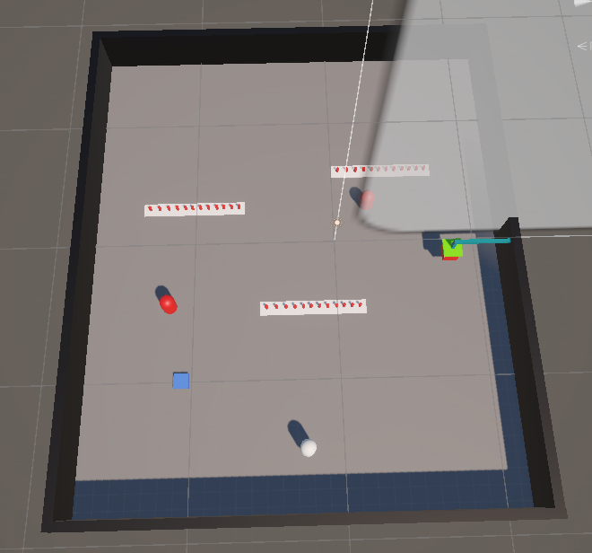
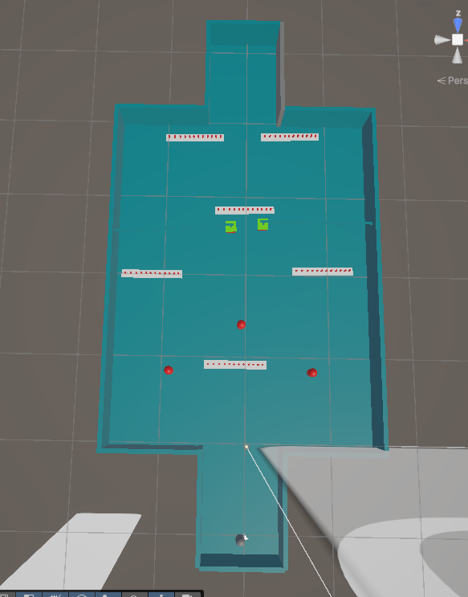
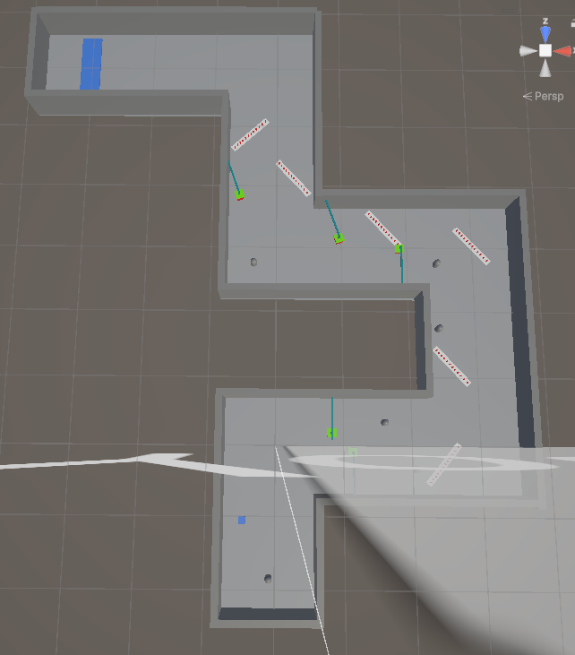
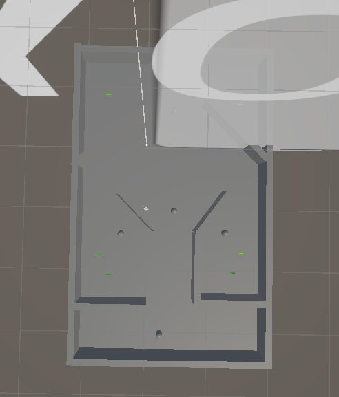
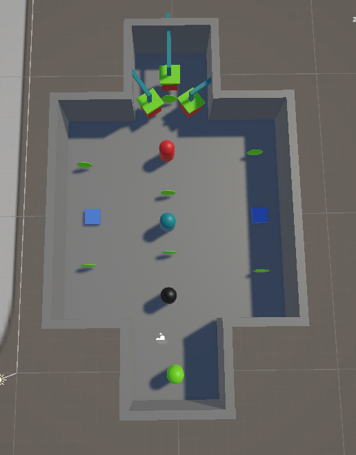

# ITU CS-464 — Lab 06
# Roll No : BSCS25031

Recreated the Lecture 07 arena game in Unity and extended it into five levels.  
Each level has a different layout, objective, and increasing difficulty.  
The game uses coin collection, enemies, obstacles, power-ups, and a health/lives system.  
The reference images below show the blockout of each level.

## Level 1
**Reference Image**

## Level 2
**Reference Image**

## Level 3
**Reference Image**

## Level 4
**Reference Image**

## Level 5
**Reference Image**

